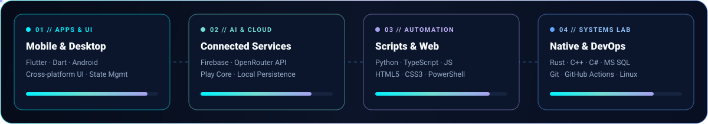
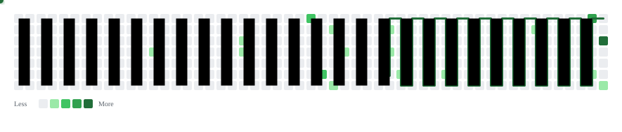

  

  

&nbsp;

&nbsp;

  

[**About**](#about) &nbsp; · &nbsp; [**Selected work**](#selected-work) &nbsp; · &nbsp; [**Toolkit**](#toolkit) &nbsp; · &nbsp; [**Activity**](#activity) &nbsp; · &nbsp; [**Connect**](#connect)

 

## About

### Hi, I'm Roni 👋

A **Flutter developer from Bangladesh**, building polished mobile experiences, desktop utilities, and developer automations that make everyday engineering feel lighter.

I care deeply about thoughtful interfaces, maintainable architecture, and solving real-world friction without unnecessary complexity.

- 🔭 **Building:** [**ZeroMind**](https://github.com/Sajedur0/ZeroMind), a multi-model Flutter AI chat client, alongside practical desktop and developer tools.
- 🌱 **Leveling up in:** advanced Flutter architecture, Python automation, and native tooling with **Rust**.
- 💡 **Focused on:** cross-platform apps, Android plugin ecosystems, and one-click workflow utilities.
- 🌐 **Digital home:** [**sajedur0.online**](https://www.sajedur0.online)

 

## Selected work

Handcrafted projects spanning AI chat interfaces, desktop workflow utilities, native Android plugins, and systems tools. Click any card to inspect the source code and documentation.

  

 

<b>⚡ More repositories from my workspace</b>

 

| Project | Focus & Stack |
| :--- | :--- |
| [**Android SDK Installer**](https://github.com/Sajedur0/Android-SDK-Installer) | Streamlined Android SDK setup tooling · `PowerShell` |
| [**Google Play Scrapping**](https://github.com/Sajedur0/Google-Play-Scrapping) | Play Store metadata & app scraping toolkit · `TypeScript` |
| [**Google Photos Remover**](https://github.com/Sajedur0/Google-Photos-Remover) | Automated cloud photo cleanup utility · `JavaScript` |
| [**Icon Maker**](https://github.com/Sajedur0/Icon-Maker) | High-speed desktop icon generation tooling · `C++` |
| [**Payroll Management**](https://github.com/Sajedur0/Payroll-Management) | Attendance & payroll management with MS SQL · `C#` |
| [**Python Tools**](https://github.com/Sajedur0/Python-Tools) | Collection of personal Python automation scripts · `Python` |

<a href="https://github.com/Sajedur0?tab=repositories"><b>Browse all repositories →</b></a>

## Toolkit

  

 

| Domain | Technologies & Tools |
| :--- | :--- |
| **Apps & interfaces** | `Flutter` · `Dart` · `Firebase` · `Android` · `Desktop UI` |
| **Scripts & web** | `Python` · `TypeScript` · `JavaScript` · `HTML5` · `CSS3` · `PowerShell` |
| **Systems & native** | `Rust` · `C++` · `C#` · `MS SQL` |
| **Development workflow** | `Git` · `GitHub Actions` · `VS Code` · `Android Studio` · `Linux` |

## Activity

Live snapshots of my public GitHub activity and contribution graph. *(External stats cards may occasionally be cached; [my GitHub profile](https://github.com/Sajedur0) is always the source of truth.)*

  

<picture>
  <source media="(prefers-color-scheme: dark)" srcset="github-contribution-grid-snake-dark.svg" />
  <source media="(prefers-color-scheme: light)" srcset="github-contribution-grid-snake.svg" />
  
</picture>

## Connect

Have a Flutter question, a developer tool idea, or an open-source collaboration in mind? **Let's build something great together.**

&nbsp;

&nbsp;

&nbsp;

&nbsp;

  

**Thoughtful apps. Useful tools. Always learning.**

*Thanks for stopping by — see you in the commit history.*

 

