

<picture>
  <source media="(max-width: 640px)" srcset="header-mobile.svg" />
  
</picture>

  

&nbsp;

&nbsp;

  

[**Google Play Apps**](#google-play-apps) &nbsp; · &nbsp; [**Projects**](#projects) &nbsp; · &nbsp; [**Connect**](#connect)

 

<picture>
  <source media="(max-width: 640px)" srcset="divider-mobile.svg" />
  
</picture>

## Google Play Apps

Android applications published on Google Play — fast, private, and made for everyday tasks.

<a href="https://play.google.com/store/apps/details?id=com.routerpagesetup"><picture>
  <source media="(max-width: 768px)" srcset="assets/app-router-page-setup-mobile.svg" />
  
</picture></a>

 

<a href="https://play.google.com/store/apps/details?id=com.apkorganizer"><picture>
  <source media="(max-width: 768px)" srcset="assets/app-apk-organizer-mobile.svg" />
  
</picture></a>
<a href="https://play.google.com/store/apps/details?id=com.diskcalc"><picture>
  <source media="(max-width: 768px)" srcset="assets/app-disk-calc-mobile.svg" />
  
</picture></a>

 

<a href="https://play.google.com/store/apps/details?id=com.mictospeaker"><picture>
  <source media="(max-width: 768px)" srcset="assets/app-mic-to-speaker-mobile.svg" />
  
</picture></a>
<a href="https://play.google.com/store/apps/dev?id=5574132061091657048"><picture>
  <source media="(max-width: 768px)" srcset="assets/app-pinsaver-mobile.svg" />
  
</picture></a>

  <a href="https://play.google.com/store/apps/dev?id=5574132061091657048"><b>Google Play Store Profile →</b></a>
  &nbsp; · &nbsp;
  <a href="https://sajedur0.github.io/Privacy-Policies/"><b>App Privacy Policies →</b></a>

<picture>
  <source media="(max-width: 640px)" srcset="divider-mobile.svg" />
  
</picture>

## Projects

All desktop utilities, mobile apps, browser extensions, and web tools created by me.

<a href="https://github.com/Sajedur0/ZeroMind"><picture>
  <source media="(max-width: 768px)" srcset="assets/card-zeromind-mobile.svg" />
  
</picture></a>
<a href="https://github.com/Sajedur0/Project-Backup-Tools"><picture>
  <source media="(max-width: 768px)" srcset="assets/card-backup-tools-mobile.svg" />
  
</picture></a>

 

<a href="https://github.com/Sajedur0/Temp-Cleaner"><picture>
  <source media="(max-width: 768px)" srcset="assets/card-temp-cleaner-mobile.svg" />
  
</picture></a>
<a href="https://github.com/Sajedur0/Icon-Converter"><picture>
  <source media="(max-width: 768px)" srcset="assets/card-icon-converter-mobile.svg" />
  
</picture></a>

 

<a href="https://github.com/Sajedur0/Internet-Spped-Meter"><picture>
  <source media="(max-width: 768px)" srcset="assets/card-speed-meter-mobile.svg" />
  
</picture></a>
<a href="https://github.com/Sajedur0/Payroll-Management"><picture>
  <source media="(max-width: 768px)" srcset="assets/card-payroll-mobile.svg" />
  
</picture></a>

 

<a href="https://github.com/Sajedur0/FRP"><picture>
  <source media="(max-width: 768px)" srcset="assets/card-frp-mobile.svg" />
  
</picture></a>
<a href="https://github.com/Sajedur0/Excel-Space-Remover"><picture>
  <source media="(max-width: 768px)" srcset="assets/card-excel-cleaner-mobile.svg" />
  
</picture></a>

 

<a href="https://github.com/Sajedur0/Google-Photos-Remover"><picture>
  <source media="(max-width: 768px)" srcset="assets/card-photos-remover-mobile.svg" />
  
</picture></a>
<a href="https://github.com/Sajedur0/Android-SDK-Installer"><picture>
  <source media="(max-width: 768px)" srcset="assets/card-sdk-installer-mobile.svg" />
  
</picture></a>

 

<a href="https://github.com/Sajedur0/Google-Play-Scrapping"><picture>
  <source media="(max-width: 768px)" srcset="assets/card-play-scraper-mobile.svg" />
  
</picture></a>
<a href="https://github.com/Sajedur0/in_app_update_android"><picture>
  <source media="(max-width: 768px)" srcset="assets/card-in-app-update-mobile.svg" />
  
</picture></a>

 

<a href="https://github.com/Sajedur0/PC-Software"><picture>
  <source media="(max-width: 768px)" srcset="assets/card-pc-software-mobile.svg" />
  
</picture></a>
<a href="https://github.com/Sajedur0/Privacy-Policies"><picture>
  <source media="(max-width: 768px)" srcset="assets/card-privacy-hub-mobile.svg" />
  
</picture></a>

<picture>
  <source media="(max-width: 640px)" srcset="divider-mobile.svg" />
  
</picture>

## Connect

&nbsp;

&nbsp;

&nbsp;

&nbsp;

&nbsp;

  

**Sajedur Rahman Roni**

 

